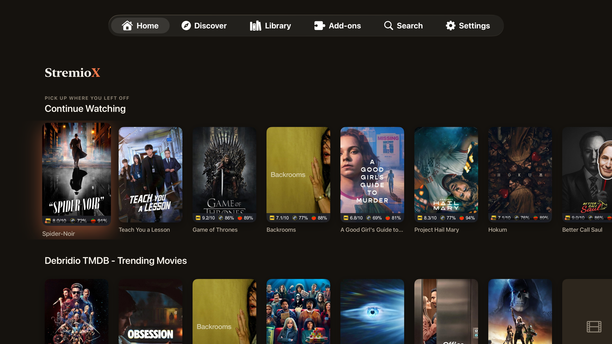
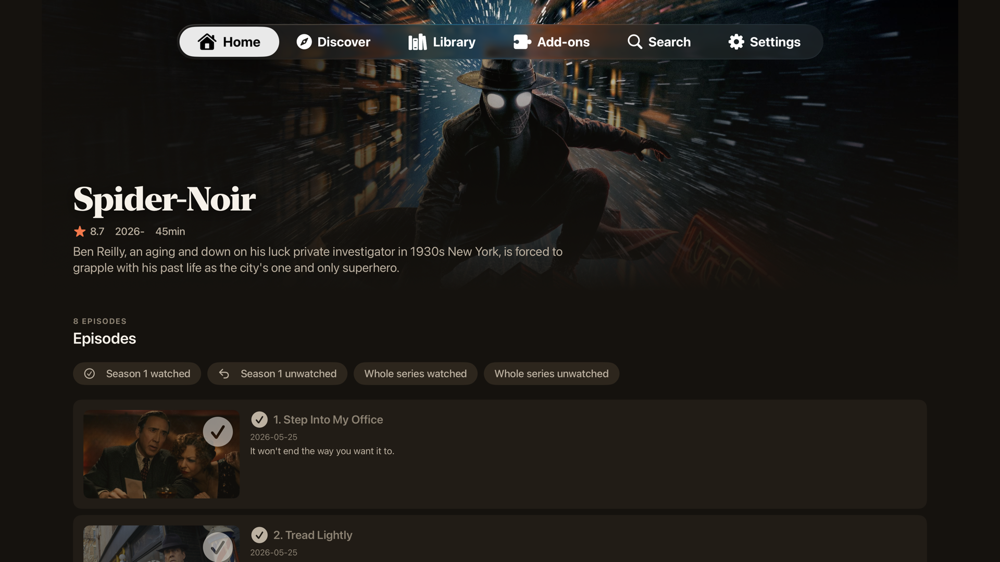
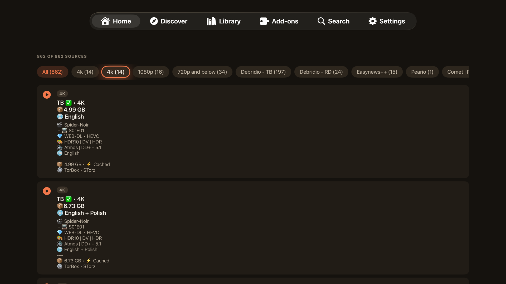
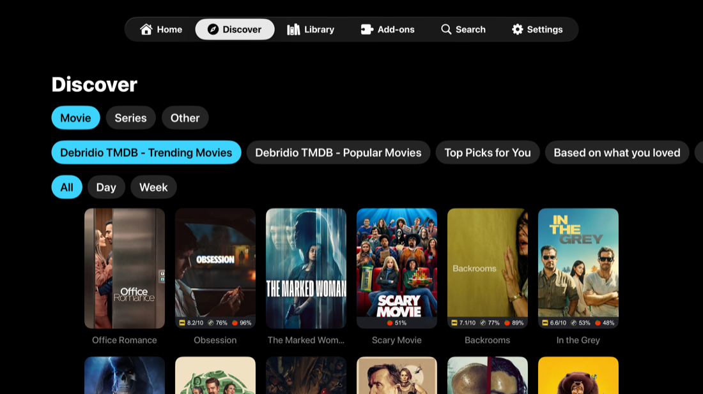
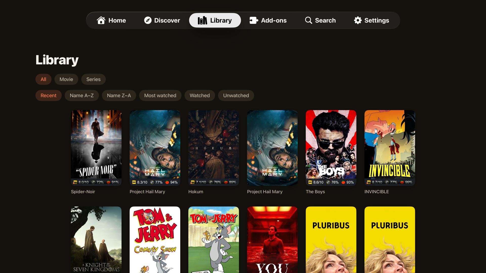
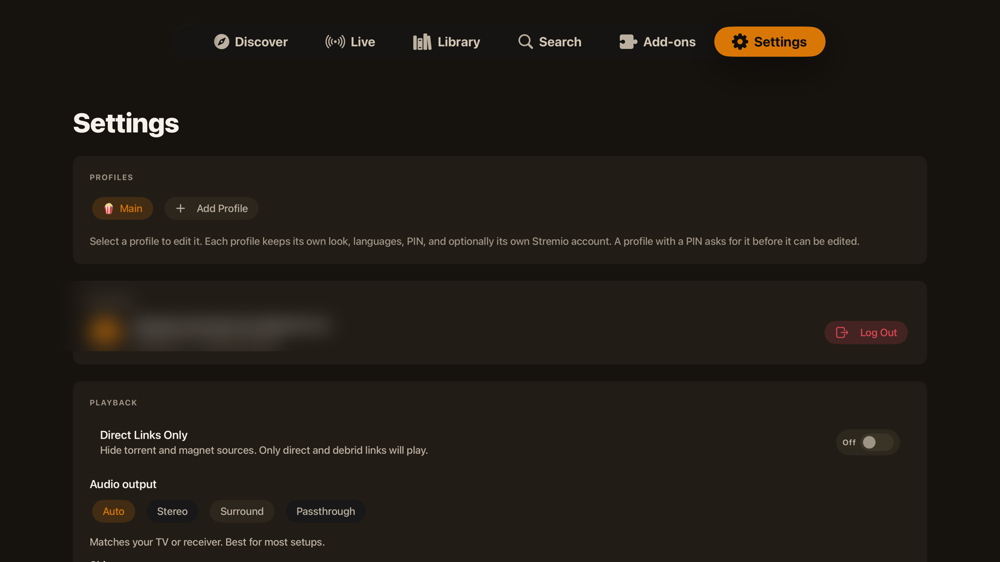
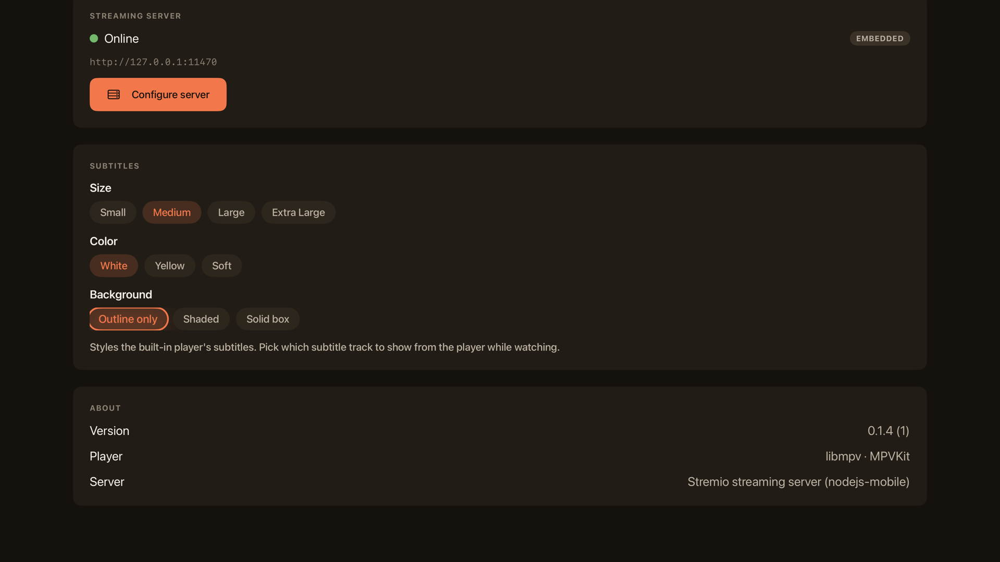
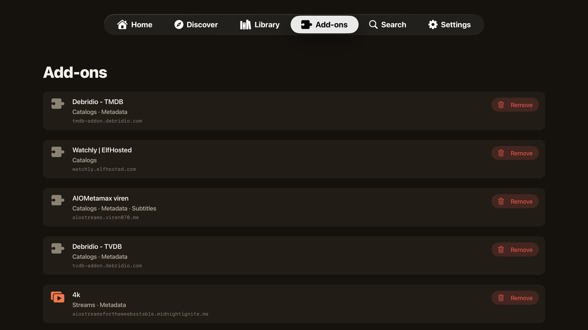

<p align="center">
  
</p>

<p align="center">
  <strong>Everything. VortXed.</strong><br>
  Your library, your sources, your screen.
</p>

<p align="center">
  <a href="https://github.com/VortXTV/VortX/releases/latest"></a>
  <a href="https://github.com/VortXTV/VortX/releases"></a>
  <a href="LICENSE"></a>
  
</p>

# VortX

VortX is a native media app for **Apple TV, iPhone, iPad and Mac**, with an **Android phone, tablet and TV app** alongside them. Browse your add-ons and personal media, pick a source and keep your profiles and progress together with a VortX account. Apple uses SwiftUI with native playback engines, not a web wrapper.

**[Download VortX](https://github.com/VortXTV/VortX/releases/latest)** · **[Installation guide](docs/INSTALLING.md)** · **[Website](https://vortx.tv)** · **[Report a problem](docs/SUPPORT.md)** · **[Community](https://www.reddit.com/r/Vortx)**

VortX is Apple first. Android is available now as a technical preview, not a promise of complete feature or playback parity. Windows/Linux desktop and LG/Samsung TV projects are in development; they are not part of the current native release package set.

## Current release

This source prepares **0.5.6, build 280** for the stable release track: native-only app composition, safer profile recovery, profile-owned live catalogs/episodes/sources, Android sign-in safeguards, lighter Apple player glass, playback recovery, richer Collections and updated native player inputs. [Download the latest published release](https://github.com/VortXTV/VortX/releases/latest); a source version is not confirmation that its packages have been published.

Removing the old comparison engine and Node runtime does **not** remove Stremio-compatible add-ons, optional Stremio account/library import or Cinemeta. Android remains a technical preview. The full Swift 6 migration, wider performance work, all dependency upgrades and remaining reported bugs are not finished. See the [changelog](CHANGELOG.md) for changes and the [roadmap](ROADMAP.md) for what remains.

## Choose your download

| Device | Package | Minimum system |
| --- | --- | --- |
| iPhone / iPad | iOS `.ipa` | iOS / iPadOS 16 |
| Apple TV | tvOS Full or Lite `.ipa` | tvOS 18 |
| Mac, Apple silicon | macOS `.dmg` | macOS 14 |
| Android phone / tablet / TV | Full MPV or Media3 `.apk` | Android 8.0 / API 26 |

The Apple IPAs need compatible sideload signing. The Mac app is ad-hoc signed, not notarized. An Android APK contains both the phone and TV interfaces; there is no separate phone-only or TV-only APK. The `.aab` is a distribution bundle, not a file to install directly.

### Apple TV: Full or Lite?

| | VortX TV | VortX TV Lite |
| --- | --- | --- |
| Direct HTTP(S) and resolved debrid sources | Yes | Yes |
| Embedded native streaming transport | Yes | No |
| Raw torrents / magnets | Yes | No, Direct Links Only is enforced |
| Apple TV Top Shelf extension | Yes | No |
| Best fit | You want the embedded streaming path | You only need sources already resolved to direct links |

Full also offers **Direct Links Only** in Settings. A direct link does not guarantee privacy, availability or permission to view the content. Full and Lite have different application identities; do not assume installing one replaces the other or moves its device-local settings.

Exact filenames, checksums and distribution differences are explained in [Release artifacts](docs/RELEASE-ARTIFACTS.md).

## Made for watching

### A library that feels like yours

- A cinematic Home with Continue Watching, add-on catalogs, featured artwork and trailers.
- Movie and series pages with cast, ratings, trailers, seasons, episode progress and watched controls.
- Discover, Library and Search, with catalog, type, genre and sorting controls where supported.
- Per-profile interests and **For You** rows, plus smart collections based on criteria such as genre, cast, year and rating.
- Home section and catalog hiding/reordering, so your most useful rows stay close.
- Profiles with their own name, avatar, appearance, viewing history and optional PIN.

### Your sources, in one place

- Install compatible add-ons by manifest URL and manage their visibility and ordering.
- Ranked **Watch Now**, quality choices and **All sources**, with resolution, format, file size and cached-source information when a provider supplies it.
- Debrid integrations, torrent streaming in supported builds, and Usenet/NZB support through configured services.
- Personal Plex, Jellyfin and Emby integrations, plus device-local network shares such as SMB and WebDAV.
- Bring-your-own live channels, playlists and guide data. Availability depends on the provider and platform.
- Optional Stremio import and Trakt/SIMKL integrations, separate from your VortX account.

VortX does not include a movie or television subscription. Add-ons and services can fail, return incomplete metadata or restrict content independently of the app. Use sources you are authorized to access.

### A player with room to adjust

- Native playback with libmpv and Apple's AVPlayer paths on Apple, and MPV/Media3 variants on Android.
- Audio and subtitle selection, language preferences, subtitle styling/sync, playback speed and aspect controls.
- Intro and credit skipping when timings or chapters are available, episode navigation and next-episode preparation.
- Resume, source switching, playback information, seek previews and supported external-player handoffs.
- Effects/performance controls for artwork, glass, blur and animation on supported surfaces.

HDR, Dolby Vision, surround audio, passthrough, AirPlay and Picture-in-Picture depend on the device, OS, selected player, source and output chain. A codec label is not a guarantee of identical output on every device. Player-control responsiveness and real-device validation remain active work.

## Accounts, sync and backups

**VortX account sync is available today.** It synchronizes supported account data, including profiles, settings and viewing data, through an end-to-end-encrypted account document. Device-only settings and credentials for local resources do not all travel between devices.

- **Account and sync:** open **Settings > VortX account & sync** to check the last successful sync or request **Sync now**.
- **Stremio:** connect under **Integrations > Stremio** or use **Import from Stremio**. This is optional and is not the same as signing into VortX.
- **iPhone, iPad and Mac:** **Settings > Backup & Restore** offers backup/restore and library export/import.
- **Apple TV:** **Settings > Backup & Restore** provides QR-based backup and restore through a phone/browser signed into VortX.

A backup file, a successful local save and a completed cloud sync are different things. Treat exported backups as private. If profiles do not open or sync fails, **export diagnostics before trying destructive workarounds**. Do not delete account data, Keychain items or the app to make an error disappear. See [Help and diagnostics](docs/SUPPORT.md).

## A look at the Apple TV app

Screenshots illustrate the interface; individual controls and layouts can differ in newer releases and on other devices.

### Home and details





### Sources and playback




### Discover, Library and profiles







### Settings and add-ons





## Install and update

Start with the [installation guide](docs/INSTALLING.md). Download from the **official GitHub release**, check its version and choose the same app variant and signing identity when updating. Do not uninstall first just to update.

On Mac, drag the app from the DMG into Applications. If macOS blocks the official download, the guide explains **Open Anyway** and this quarantine-removal command:

```sh
xattr -dr com.apple.quarantine /Applications/VortX.app
```

This removes the download quarantine flag. It does not notarize the app or prove it safe.

Update feeds, the website and `dl.vortx.tv` can follow a different channel from a named beta. To test a specific version, use that release's own assets, not a redirect assumed to mean the newest beta.

## Security and privacy

- The app contacts VortX account/metadata services, your configured add-ons and providers, and optional integrations you enable. Playback can contact the selected media host or peers when using torrents.
- Account secrets and encrypted backups need care. Never post passwords, tokens, private source URLs, backup files or encryption keys in an issue.
- Checksums identify downloaded bytes; provenance records connect packages to source and build runs. Neither replaces reviewing the code or trusting the publisher.
- The public app repository and proprietary engine dependencies are different licensing and access boundaries. A full shipping build is not reproducible from this public repository alone without those dependencies.

Report security vulnerabilities through [private vulnerability reporting](https://github.com/VortXTV/VortX/security/advisories/new), not a public issue. See [SECURITY.md](SECURITY.md).

## Development and documentation

Apple uses Swift/SwiftUI, native Rust engine interfaces, libmpv/MPVKit and AVPlayer. Android uses Kotlin/Jetpack Compose with native engine integration. The [browser client](webapp/README.md) has a different playback capability boundary from the native apps.

- [Documentation index](docs/README.md)
- [Installation](docs/INSTALLING.md) and [help / diagnostics](docs/SUPPORT.md)
- [Release artifacts](docs/RELEASE-ARTIFACTS.md) and [native packaging](docs/native-release-packaging.md)
- [Build and source boundaries](docs/BUILDING.md)
- [Changelog](CHANGELOG.md), [roadmap](ROADMAP.md) and [contributing](CONTRIBUTING.md)

## Credits

- [Stremio](https://www.stremio.com/) and its contributors, for the add-on ecosystem and foundational work used by earlier versions.
- [mpv](https://mpv.io/) and [MPVKit](https://github.com/mpvkit/MPVKit), for the player.
- [nodejs-mobile](https://github.com/nodejs-mobile/nodejs-mobile), for the embedded runtime used by earlier releases. Current native release packages omit that legacy runtime.
- [OrigamiSpace](https://github.com/OrigamiSpace), for QR sign-in, live playback, search, resume/watched controls, TV focus, release verification, Direct Links Only, Lite and continued community contributions.
- [jbecker-it](https://github.com/jbecker-it), for the player reliability work around pause handling, progress, seeking, audio and Continue Watching.
- [SkipDB](https://skipdb.tv) and TheIntroDB community, including [OrigamiSpace](https://github.com/OrigamiSpace)'s SkipDB work, for community skip data. Lookup and contribution paths depend on the provider and configuration; not every submission is forwarded to every service.
- Everyone who reports bugs, shares carefully redacted diagnostics, translates or contributes fixes.

See [THIRD-PARTY-NOTICES.md](THIRD-PARTY-NOTICES.md) for third-party notices. Credits for historical components do not imply those components remain in current packages.

## License and independence

The public application code is licensed under [GPL-3.0](LICENSE). Proprietary engine dependencies and third-party components have their own access and licensing terms. The VortX name and logo are covered separately by [TRADEMARK.md](TRADEMARK.md). Contributions require the [CLA](CLA.md); see [CONTRIBUTING.md](CONTRIBUTING.md).

VortX is independent and is not affiliated with or endorsed by Stremio, Apple or any content provider. It is a client for sources you supply, not a content host. See the [legal and third-party add-on policy](docs/LEGAL.md).

[View Star History](https://www.star-history.com/#VortXTV/VortX&Date)
